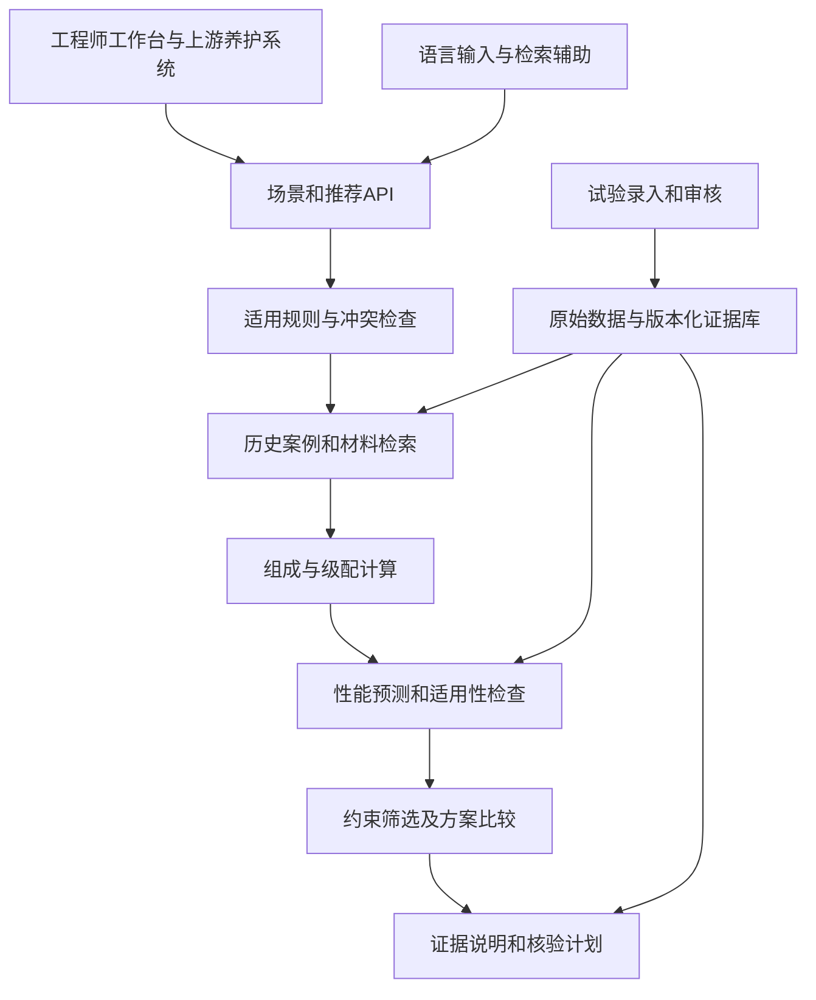

# 数智选材赛题分析与作品详细设计

设计日期：2026年10月18日。面向企业课题一，供团队确定作品范围、原型交互、算法实验与开发任务。

建议作品定位为：**面向再生沥青混合料的场景推荐与试验决策系统**。养护工程师输入已确定的养护工法、结构层、气候与交通条件，系统形成有出处的性能要求，从可用料源与企业配方中筛选候选，展示性能依据和未解决的问题，再给出材料工程师需要核验的配方与试验计划。

技术主线采用“场景规则与案例检索、料源表征与多性能代理、风险约束下的推荐、方案与试验项目联合选择”。首版以 AC 类再生混合料和现有企业产品为范围。小样本基础模型、多任务学习与主动试验规划通过对照实验决定是否进入主流程。

# 1 赛题要求与作品范围

## 1.1 本次选择的课题

企业 PDF 共10页。第1至5页为课题一“数智选材”，第6至10页为课题二“智检快评”。现有调研和实验工作簿直接支撑课题一的材料推荐环节。FTIR与NIR光谱不在当前数据中，因此本次设计围绕课题一展开。

课题一要解决的业务断点是：养护决策已经给出“怎么修”，工程师仍需花费时间把工法转换为可实施的材料方案。作品需要连接场景、性能要求、配方与验证，推荐引擎是核心。

## 1.2 成果要求逐项落实

以下为任务书成果对照，不代表赛事已公布的评分权重。

| 任务书要求 | 作品中的具体成果 | 验证方式 |
|---|---|---|
| 技术方案与可演示原型 | 场景输入、性能要求确认、候选推荐、依据展开、人工微调 | 一次完整操作可以保存推荐记录 |
| 至少3类场景的结构化知识库或数据模型 | 高温车辙、温缩开裂、水损害三类规则卡及材料关联 | 每类能检索规则出处和候选方案 |
| 不少于5个典型场景案例 | 本稿第10节的5个构造场景，使用企业历史记录回放 | 展示输入、候选、排除理由与基准对比 |
| 可复用的技术交接 | 数据字典、字段映射、规则文件、接口契约、计算与模型版本 | 企业能够重跑同一案例 |
| 应用价值分析 | 选型用时、人工操作量、候选匹配和核验工作量 | 在同一任务与信息条件下比较 |
| 加分成果 | 多性能预测、区间分析、约束优化、主动补测和独立实测 | 分别提供实验结果和适用边界 |

任务书允许采用规则库、数据库等实现结构化知识底座，不要求使用特定图数据库；明确以创意方案为主，不要求完成全部工程系统。首版应优先形成可追溯的推荐流程和可信的案例，随后用模型与实验增加技术深度。

## 1.3 首版范围

首版覆盖企业提供的AC类混合料、表内名义RAP比例和可识别的沥青配方。四项主要性能为动稳定度DS、最大弯拉应变、冻融劈裂强度比TSR、浸水马歇尔残留稳定度比。体积指标作为试验核验的重要部分。

养护工法由上游系统或工程师确定。裂缝场景先区分温缩、疲劳、反射等成因；只有温缩开裂可主要使用当前低温弯曲证据进行辅助选型。结构性车辙、排水缺陷等问题需要保留相应工程处治前提。

PG等级、疲劳寿命、动态模量、抗滑、施工温度优化和现场寿命设为扩展指标。场景明确要求这些指标时，推荐记录保留“缺少相应证据”的状态，不能用DS、低温应变等替代。

# 2 官方工作簿的实际支撑能力

## 2.1 重新统计的规模

以下由当前工作簿重新读取计算，原文件保持不变。

| 数据部分 | 本轮统计 | 对设计的影响 |
|---|---:|---|
| 工作表 | 9张 | 包含设计流程、原料、级配与5类试验表 |
| 原料档位记录 | 244条 | 支撑筛分曲线与原料表征 |
| 唯一级配方案块 | 68块 | 级配不是完整配方身份，仍需区分产品和油石比 |
| 级配中的来源代码 | 44个 | 匿名代码不等于44个独立物理料源 |
| 体积指标明细 | 642条 | 包含同方案平行试件及不同用油方案 |
| 浸水马歇尔明细 | 411条 | 原表保存83个残留稳定度汇总值 |
| 冻融劈裂明细 | 528条 | 原表保存87个TSR汇总值 |
| 高温车辙明细 | 158条 | 按保留局部方案标识的规则形成86个操作性分组 |
| 低温弯曲明细 | 313条 | 312条应变数值，另有1条缺测标记 |
| 上述5表明细合计 | 2052条 | 不能作为2052个独立配方或独立批次训练 |

68个级配块中，AC-13为39块、AC-20为22块、AC-10为6块、AC-25为1块。66块含RAP、2块为零RAP对照。表内名义RAP比例最高70%；50%占41块、60%占11块、70%占7块。这一分布支持以高RAP再生体系为特色，也提示零RAP对照与部分级配类别样本较少。

按“来源、完整级配、局部产品、记录油石比”形成的初步键数为：体积指标117、浸水83、冻融89、车辙86、低温81。冻融键数多于TSR汇总数，部分键没有单独TSR标签。这些是整理过程中的操作性统计，最终模型样本数应在别名、批次和质量状态核验后冻结。

## 2.2 影响作品设计的数据问题

**单位必须显式转换。** TSR数值存为约0.74至0.95，而残留稳定度存为约79.30至95.38。TSR有些单元格显示百分号、有些没有。入库统一为百分数，并保留原值、原单位、显示格式和转换规则，避免把0.89与89混用。

**汇总行与独立试件必须区分。** 21个车辙操作性分组中，第三条值恰好等于前两条的算术均值。例如“高温车辙”K99至K101为5289、5116、5202.5。该规律足以标记为疑似派生均值，尚不能认定第三条一定不是独立试验。确认前，不能把它当作第三个独立样本估计试验方差。

**跨表身份需要逐层核验。** 来源与完整级配可以建立大部分关联，但存在局部标识差异。例如体积表中的M-1、AC-13-3产品记为“90#-3”，其他性能表记为“90#”。它们可形成待确认关联，不能据此自动合并体积与路用性能。B与B-2、1G的AC-13与AC-13-1、1K局部AC-13与AC-10也应分别处理，不要求企业重新解释全部级配。

**原始曲线与表内引用曲线需要保留两套状态。** 例如A来源5至10mm粗集料在原料表D4至O4与级配表G4至R4不一致。先记录差异、来源和可能的引用问题，再由确认后的版本生成模型特征；不能直接认定同名档位一定属于同一批原料，也不能覆盖原始数据。

**用油异常不能当成有效实验扫描。** 低温表T来源第143至148行的沥青用量约为4.03%、5.03%直至9.03%，对应油石比约4.20%至9.93%；其他试验记录约为4.2%，级配设计栏又为4.6%。这些行需要字段级待核验标记，不能直接据此学习“用油量变化的性能规律”。

**公式错误应按字段隔离。** 原料表AJ3与AJ4存在Excel公式错误。它们不意味着同一行筛分曲线等其他可信字段全部失效。清洗过程应精确到字段、公式与来源。

这些问题使“依据追溯、身份关联、缺测处理、风险提示”成为产品功能，也使它们成为算法实验需要控制的变量。

## 2.3 证据层次

每项数据分别保存：原始记录、可重算的派生值、参考属性、模型预测、人工确认结果。疑似均值不作为独立观测；试验条件没有记录时填写未知，不将设计流程中的通用条件自动回填为每次实测条件。

工作簿“设计流程”提供的参考条件可用于规则原型，包括DS>800次/mm、最大弯拉应变>2000με、TSR>75%、残留稳定度比>85%、稳定度>8kN、流值2.0至4.0mm，以及VV参考范围。它们是企业流程参考，不能直接宣称为任意地区、结构层和材料体系的验收要求。具体标准条文及适用范围需要作为独立规则记录。

# 3 产品定位与核心使用流程

## 3.1 两类用户

养护工程师需要知道哪些材料适合当前工程、为什么推荐、还有哪些条件没满足。材料工程师需要看到准确的料源和产品身份、设计变量、原始试验依据，以及接下来值得验证什么。

推荐首页应回答四件事：当前工程要求是什么；哪些候选进入核验；每个候选有哪些已测或预测依据；完成确认还需哪些试验和工程条件。

## 3.2 完整流程


原型必须支持候选为空、缺少关键指标、规则冲突、未见料源和人工修改五种状态。人工改变油石比、RAP比例或产品后，应生成新方案版本，重新计算级配与预测，并使原确认结果失效。

# 4 数据模型与关联规则

## 4.1 主要实体

| 实体 | 关键内容 | 关系与约束 |
|---|---|---|
| 原料与批次 | 来源代码、材料类型、粒径、批次、筛分曲线、密度、RAP含油量 | 同名原料可有不同批次 |
| 级配方案 | 完整级配标识、各档比例、曲线版本、表内名义RAP比例 | 不把AC-13作为唯一键 |
| 沥青产品版本 | 产品族、企业局部配方标记、披露的属性 | 不由“110#-1”猜测化学配方 |
| 配方方案版本 | 原料比例、产品、总用油和新加油、质量口径 | 每次修改产生新版本 |
| 试验组与试件 | 试验项目、制样批次、条件、试件编号、干湿或冻融分组 | 分清平行试件与汇总行 |
| 性能观测 | 数值、单位、聚合方式、有效性与测量状态 | TSR按对应冻融与对照组均值比形成 |
| 证据记录 | 文件哈希、表名、单元格、原公式、转换、确认人 | 每个派生值可追溯 |
| 场景与规则 | 工法、气候、交通、结构层、病害、规则出处及适用范围 | 阈值与试验方法同时保存 |
| 推荐与验证任务 | 输入快照、候选、排除理由、模型版本、待验证事项 | 保留人工修改与审核轨迹 |

建议使用关系数据库保存实体与证据边，以规则文件表达适用逻辑。初期可以通过查询形成“场景要求某性能、方案采用某材料、试验支持某判断”的关系视图。达到复杂路径推理需求后，再决定是否引入专用图数据库。

## 4.2 主键和分组

级配键先由“来源代码＋去除空白后的完整级配标识”形成。产品键保留局部方案身份，不能全局把“90#”合并成一个产品。实验身份进一步加入实际油石比、试验条件和批次。

每条关联保存`exact`、`confirmed_alias`、`conditional`或`unresolved`状态及依据。仅因数值相近、标号相同或名称相似，不建立训练标签的确定关联。M-1与M等来源关系需要结合完整原料曲线组合和材料说明判断。

数据划分使用的分组另行保存。完整配方、平行试件、疑似派生均值和同一材料曲线组合不能跨训练与测试。共享某一档矿粉曲线不应自动把所有料源合并成同一组，应比较完整、有效的材料表征。

# 5 场景规则与性能要求

## 5.1 场景输入

必填信息为已选工法、拟用结构层、可用材料和明确的目标要求。气候分区、交通等级、病害类型与严重程度、工期、设备限制作为规则匹配条件；某项条件不足以定位适用条文时，应提示补充条件或由工程师选择规则，不能填入默认地区。

三类场景分别强调抗车辙、低温抗裂、水稳定性，但所有适用的硬要求仍需满足。权重仅决定可行候选间的偏好，不能用高DS补偿低于下限的TSR。

## 5.2 规则卡

每条规则保存规则ID、出处、版本、生效日期、条款位置、适用工法与结构层、材料体系、试验方法、调理条件、指标、单位、比较运算符、阈值和人工确认状态。

标准规则、企业经验、项目自定义目标和演示假设分别标注。规则冲突时先核对适用范围、单位和试验条件；只有同一口径下才比较要求的严格程度。没有明确适用关系的冲突交由工程师确认，不由语言模型自行取舍。

现行试验规程的官方发布信息确认JTG 3410—2025自2025年10月1日起施行，并替代JTG E20—2011。历史数据仍需保留实际试验版本。[交通运输部发布公告](https://xxgk.mot.gov.cn/jigou/glj/202508/t20250822_4175218.html)

再生体系同时需要核对JTG/T 5521—2019及项目适用要求；发布公告本身不能提供所有场景的具体性能阈值。[交通运输部再生技术规范公告](https://xxgk.mot.gov.cn/jigou/glj/202006/t20200623_3313172.html)

# 6 数值计算与模型路线

## 6.1 先建立可执行计算

在确认质量基准后，若`q_i`表示各档矿料占总矿料的质量分数，应满足非负及`sum(q_i)=1`，筛孔通过率按`P_k=sum(q_i*P_ik)`合成。级配包络及各档可用范围按适用规则核验。没有分档比例、只有成品曲线的记录作为另一种输入类型处理。

油石比和沥青用量必须保持一致分母。若油石比为`r%`，则沥青占混合料百分数为`100*r/(100+r)`。RAP混合料质量与抽提后矿料质量也应分别保存；若RAP比例按含油材料质量给出，需先依据其含油量转换到矿料基准，再计算合成级配与旧沥青贡献。

旧沥青名义贡献可按统一基准核算，但旧沥青活化和融合程度是另一个物理问题。旧沥青仍计入质量守恒，其实际贡献不能由RAP比例直接认定为100%有效。首版以可验证的组成、比例、级配和用油一致性为机理约束，不将其称为已经实现PINN。

## 6.2 输入特征与标签

设计前模型使用：经核验的原料曲线及比例、合成级配特征、表内名义RAP比例及确认后的质量口径、可信RAP含油量、产品版本、实际设计用油、明确的制样条件。未知或仅为参考模板的沥青属性应设缺失或单独状态。

实测VV、VMA、稳定度、其他路用试验结果等属于设计后信息。它们可进入“已有部分试验后辅助补测”的第二类任务，不能进入首轮配方预测并据此宣称设计前精度。由同一公式相互推导的强度、应变与劲度也不能随意互为输入来证明独立预测能力。

标签先按确认的试验组形成，保存每组有效试件数、聚合方法、极差及可获得的批次信息。组均值、单试件性能和未来生产批次是不同预测目标，区间与评价必须对应同一目标定义。

## 6.3 模型比较顺序

| 路线 | 方法 | 进入主流程的条件 |
|---|---|---|
| 业务基线 | 适用规则、历史案例检索、近邻候选 | 可追溯并能完成5类场景流程 |
| 透明预测基线 | 岭回归或SVR、随机森林、树提升模型 | 严格分组后优于简单近邻或常数基线 |
| 小样本主候选 | GPR与树模型分别训练四项性能 | 同时评估误差、区间与阈值附近误判 |
| 表格基础模型分支 | 固定版本的TabPFN | 同一划分、允许的训练信息及授权下比较 |
| 多任务分支 | 多任务GP或带缺失标签掩码的共享表征 | 配方关联可信，共享标签足够，验证无明显负迁移 |

先分别建模四项性能，再根据真实关联覆盖决定是否共享表征。没有实测标签的指标不通过生成数据补成“独立样本”。基础模型也需要按本项目的料源外测试判断价值。

TabPFN官方仓库将代码和模型权重许可分开，多个新版权重采用非商业许可。设计阶段保留模型可替换接口，企业交付时核对选定版本与使用授权。[TabPFN官方仓库](https://github.com/PriorLabs/TabPFN)

# 7 推荐算法与不确定性

## 7.1 候选产生

第一层从已知企业产品与历史方案中枚举、检索；第二层才在有依据的局部比例与用油范围内提出新候选。新方案必须满足原料可用、比例守恒、适用级配和明确的施工条件。产品化学配方没有披露时，以企业产品版本进行离散选择，不生成不存在的助剂掺量。

有限候选优先采用硬筛选、可行集Pareto比较和可解释排序。只有连续空间确有价值时，再使用受约束贝叶斯优化或NSGA类算法。目标是达到所需性能并兼顾资源与成本偏好，而非把所有性能无限做大。

## 7.2 推荐状态

| 状态 | 判定依据 | 用户看到的行动 |
|---|---|---|
| 有依据进入核验 | 身份及适用条件清楚，必要指标有相应证据或通过模型核验条件 | 比较候选并安排确认试验 |
| 需要补测或确认 | 指标缺测、区间跨阈值、材料身份未确认或分布外 | 指明缺什么、优先测什么 |
| 当前要求下排除 | 硬约束冲突或有明确不满足目标的证据 | 列出具体约束及可修改条件 |

这些状态不能替代工程验收。原表历史聚合值与新配方预测值采用不同来源标签；任何“全部满足”都必须显示其所覆盖的指标、试验条件和仍待完成的核验事项。

## 7.3 预测区间的使用

对下限要求，风险筛选可以比较预测区间下界与阈值；区间与阈值相交时提出补测。GPR后验区间需要检查实际覆盖，可比较分位数、集成与共形校准。试件极差仅描述现有记录，不能展示为预测区间。

共形校准依赖相应可交换性等条件，普通边际覆盖不自动等于每个料源、优化后候选或四项性能联合达标保证。[共形预测方法原文](https://arxiv.org/html/2107.07511v6)

小样本还限制区间分辨率。例如采用Bonferroni将四指标联合90%目标分成每项2.5%误差额度时，简单分割共形的有限分位数通常至少需要每项39个校准组；联合95%时为79个。其他联合分数方法可以有不同的数据效率，但需要可信的完整多指标校准组及相应假设。当前不预设“95%联合达标概率”作为演示数字。

分布外判断先使用训练期确定的物理范围、材料曲线距离和未见产品状态。此类判断输出适用性提示；距离本身不称为置信度。没有料源外验证支持时，对未见料源采用案例参考和试验建议。

# 8 主动试验规划与反馈

联合决策对象为“配方方案、试验项目”，例如同一候选应先做低温弯曲还是水稳定性试验。首版先使用规则：优先核验影响候选去留的缺测指标、临界指标和高风险场景的核心性能。

研究增强版比较：随机选择、专家规则、最大不确定性、普通BO、考虑试验成本的信息价值策略。成本拆分为共同制样、单项目检测、批次组织与周期；无真实费用时报告查询次数，并单独标明情景成本假设。

历史池回测隐藏整组标签，每轮仅揭示被选择的真实结果。重复相同起始条件并保留独立评价集，比较找到首个可行方案所需查询数、相同预算下的目标满足和关键歧义减少。该回测验证池内选择策略，追加新配方仍需独立实测。

实验与工程反馈分层回流。实验室性能用于相应代理模型；现场交通、天气、施工和病害跟踪形成工程验证数据，不能直接把现场车辙深度回填为实验室DS。新数据审核后再训练，保留旧模型、候选评估与回滚版本，不采用未经评估的自动在线更新。

目标导向材料设计已有原始研究支持，但其具体材料体系和实验收益不直接转为本作品的效果。[目标导向贝叶斯优化研究](https://www.nature.com/articles/s41524-025-01704-4)

# 9 界面与交互详细设计

## 9.1 场景工作台

左侧输入工法、结构层、病害及可用料源，右侧展示匹配的规则卡、性能目标和待补条件。自然语言输入可以辅助填表，工程师确认结构化结果后才进入数值流程。页面保留规则出处与目标修改记录。

## 9.2 材料与数据依据

展示产品版本、原料曲线、名义RAP比例、用油口径和可用试验。点击一个数字可展开表名、单元格、原始值与转换。名称关联未确认时，明确显示待确认字段和对哪些功能产生影响。

## 9.3 推荐与方案比较

默认展示候选列表、四项性能及来源、目标差距、未满足条件和待做试验。候选按核验状态分区，区内再按项目偏好排序。雷达图仅作为辅助展示，缺失维度留空，成本和碳排没有数据时不绘制虚构半径。

点击候选展开试件分布、历史案例、预测区间和局部敏感性。SHAP等解释标注为模型关联贡献；通过固定料源和其他变量的敏感性分析检查变化方向，因果结论需要相应设计实验。

## 9.4 配方微调

编辑各档比例、允许的产品和用油范围，实时显示比例总和、合成级配及约束冲突。修改后建立新方案，刷新预测并显示是否超出训练支持范围。前一版本的实测值仍作为历史对照，不能自动成为修改方案的已测性能。

## 9.5 试验与反馈

生成待验证列表，逐项列出试验目的、关联候选、影响的决策和所需条件。录入新实验后，先完成单位、组别、公式与身份复核，再更新候选比较。保留未通过的结果，避免只回流成功试验。

## 9.6 报告导出

报告包含场景快照、适用规则、方案版本、四项性能依据、排除理由、未完成事项、核验计划及数据和模型版本。导出行为不改变候选的审核状态。

# 10 五个场景的具体回放设计

## 10.1 回放数据与口径

本轮已经建立9个历史候选的小型演示子集，并运行以下5个合理构造场景。场景不是原表已确认的真实道路项目，匿名来源不对应推定的城市气候。计算使用原表记录聚合值，不能据此声称模型预测精度或工程验收通过。

下表列出回放中的部分候选。DS及应变采用对应记录算术均值，TSR与残留稳定度采用原表保存的组汇总值；TSR换算为百分数。名义RAP比例沿用级配表口径。

| 候选 | 名义RAP | DS 次/mm | 应变 με | TSR % | 残留稳定度 % |
|---|---:|---:|---:|---:|---:|
| S AC-13 70# | 60% | 9327.30 | 2064.20 | 89.79 | 87.81 |
| M-1 AC-13-3 90# | 60% | 7316.50 | 2525.00 | 84.97 | 88.28 |
| 1B AC-13-3 局部130#方案 | 70% | 6260.00 | 2225.67 | 92.74 | 88.88 |
| 1L AC-13-1 局部90#方案 | 50% | 3933.00 | 1763.17 | 80.99 | 82.85 |
| 1L AC-13-2 局部110#方案 | 60% | 5525.50 | 2383.83 | 89.45 | 90.94 |
| 1N AC-13 局部70#方案 | 50% | 2064.00 | 2148.31 | 80.63 | 91.36 |

例如S的70#方案对应车辙K74至K75、低温H128至H132、冻融U331、浸水Q247；1L局部110#方案对应车辙K146至K148、低温H288至H293、冻融U501、浸水Q389。完整定位保存在案例数据中。

1B、1L、1N相应车辙分组包含疑似均值第三条，尚未据此增加独立样本数。M-1的体积表配方别名未自动关联。以下“进入核验”只表示所展示的四项历史聚合值满足演示目标，其余身份、级配和工程条件仍需确认。

## 10.2 高温重载车辙处治

可用候选限定为S的70#、110#-1、110#-2，保持同一来源及级配。目标为DS>8000、应变>2000、TSR>75%、残留稳定度>85%。其中DS>8000是团队构造目标，其余沿用企业流程参考。

70#方案进入核验，其余两个候选DS均值约7538.46与7240.91，未满足该演示目标。70#方案部分低温试件仍低于2000με，界面应显示组内分布并提示复核；均值超过目标不能解释为未来所有试件稳定通过。

## 10.3 寒冷地区温缩裂缝处治

可用候选为上述S方案与M-1的90#方案。目标为应变>2500、DS>800、TSR>75%、残留稳定度>85%。2500为团队演示目标，不宣称为某寒冷地区统一限值。

按DS最高的简单选法会选S，但其应变均值2064.20未满足目标。联合检查使M-1方案进入核验，其应变均值2525.00接近目标，应优先复核低温表现与配方身份。该案例展示场景改变选型结果。

## 10.4 水损害路段修复

可用候选为1L的两种局部方案及1N的90#、70#方案。目标为TSR>85%、残留稳定度>90%、应变>2000、DS>800；提高后的水稳定目标为团队演示假设。

只按残留稳定度最高会选1N局部70#方案，其残稳约91.36%，但TSR约80.63%，应被该场景排除。1L局部110#方案的两项水稳定度约89.45%和90.94%，同时满足所设四项目标，进入核验。该案例说明两个水稳定指标需要分别判断。

## 10.5 高RAP再生材料选型

可用候选为S的70#、1B的AC-13-3局部130#、1L的AC-13-2局部110#。目标为名义RAP至少70%、DS>6000、应变>2200、TSR>85%、残稳>85%。这些组合要求为团队构造目标。

1B方案进入核验。S虽然DS更高，其名义RAP为60%且应变未满足目标。此处只比较既有方案；由于料源、产品和级配不同，不能解释成提高RAP会提升TSR或其他性能。

## 10.6 高低温与水稳定复合约束

可用候选为S、M-1、1B及1L上述四个方案。目标为DS>8000、应变>2500、TSR>90%、残稳>90%，均为构造高要求。

四个候选均未满足全部目标。系统返回各自未满足的指标，允许工程师调整可用材料、核对目标适用性或发起局部新配方设计；不能自动降低硬要求或把最高综合分包装成达标方案。

五个案例已完成规则回放和边界检查，包括严格大于运算、缺测不判通过、TSR单位转换和无可行候选。它们可作为原型验收样例，不作为算法泛化测试集或五个独立现场工程案例。

# 11 系统架构与接口

## 11.1 模块划分



初期采用模块化单体即可：Python数值与模型服务、关系数据库、规则文件、浏览器工作台。预测器采用统一接口，支持替换逐指标模型与研究分支。长时间优化、重训练和报告任务进入后台作业，前台保留明确任务状态。

语言模型负责结构化输入建议、检索、调用数值工具和组织说明。数值、硬约束与引用由工具结果生成。核心案例流程可以使用模板说明离线运行，不能依赖聊天生成才能完成推荐。

## 11.2 主要接口

| 接口 | 作用 | 必须保存的信息 |
|---|---|---|
| POST /v1/scenarios/resolve | 解析场景及匹配规则 | 输入快照、规则版本、冲突及缺失条件 |
| POST /v1/recommendations | 形成候选和判断 | 材料目录、方案版本、每指标状态、排除理由 |
| POST /v1/predictions | 预测给定方案 | 特征版本、模型版本、预测目标、区间状态 |
| POST /v1/experiment-plans | 产生下一步验证任务 | 预算口径、试验目的、选择依据 |
| POST /v1/observations | 录入与审核试验 | 试件组、原始数据、条件及审核状态 |

推荐结果的单项指标示例：

```json
{
  "candidate_id": "S_AC13_70_v1",
  "status": "needs_review",
  "metric": {
    "name": "DS",
    "value": 9327.3038,
    "unit": "次/mm",
    "value_kind": "historical_record_aggregate",
    "target": {"operator": ">", "value": 8000, "source_kind": "demo_assumption"},
    "interval": null,
    "source": {"sheet": "高温车辙", "cells": ["K74", "K75"]}
  },
  "pending": ["原料关联与级配核验", "确认试验与工程适用条件"]
}
```

真实预测接口再返回`model_version`、区间方法和适用性判断。当前没有校准区间时返回空值，不能用固定正负百分比填充。导入同一试验时使用幂等标识，审核更正保留旧版本。

# 12 验证方案与评价口径

## 12.1 预测评价

协议A检验未见完整方案：所有平行试件、汇总行和同配方记录留在同组。协议B检验未见料源或材料表征：按来源族与完整曲线组合留出，并检查跨代码复用。划分清单版本化，所有模型共享同一外层测试组。

清洗中的确定性单位转换可以预先固定；统计填补、标准化、特征选择、超参数和区间校准只能用允许的训练数据。调参放在内层，测试组保持封存。

逐指标报告MAE、RMSE、R²、有效组数、料源分组结果和学习曲线。区间同时报告覆盖率与宽度。阈值附近单列错误放行与错误排除，不将四种量纲平均成一个“准确率”。

## 12.2 推荐评价

比较业务规则与案例基线、点预测与排序、加入组成约束、加入适用性和区间判断后的版本。只有具备必要真实指标的评价子集才计算已验证的联合达标率。

错误放行率定义为已被推荐且可核验的候选中实际不满足必要指标者占比，同时报告推荐覆盖率和可核验比例。缺测、拒绝全部和仅挑容易案例都不能获得完整性能结论。零观察失败也需要报告评价样本数及统计不确定性。

主动选择实验固定起始可见集合、候选池、预算和多次随机种子。独立测试集不参与选点，避免用同一预测器同时提出候选并充当真值。

## 12.3 主要消融实验

| 假设 | 比较 | 要回答的问题 |
|---|---|---|
| 材料表征改善泛化 | 仅站点和标号、加入完整曲线和配方身份 | 未见料源误差是否降低 |
| 质量隔离改善可靠性 | 原始统一处理、字段级核验与身份分层 | 改善是否来自真实去泄漏与错误减少 |
| 风险判断改善推荐 | 点值筛选、区间与适用性检查 | 在相近覆盖率下错误放行是否下降 |
| 主动补测改善效率 | 随机、规则、BO与联合选试验项 | 同一真实查询预算下是否更快解决选型 |

## 12.4 系统验收

验证规则边界、缺测、单位、产品别名、版本更新、候选为空以及微调后的结果失效。每个数值至少能定位到原始单元格或模型运行记录，规则说明能定位版本和条款。

效率先测系统内查询与生成报告的实际用时，再与同信息条件下的人工任务比较。材料研发周期、费用和碳排收益需真实试验或工程数据支持，不能由接口响应速度推算。

# 13 创新主张与研究边界

多性能预测、机器学习与遗传算法反向设计已有直接相关研究。BMD研究已使用多模型预测不同性能并讨论生产与再加热因素；材料信息学研究已用代理与遗传算法权衡动态模量和成本。因此，算法名称或多目标界面不足以支撑“首次提出”。[BMD原始研究机构库](https://vtechworks.lib.vt.edu/items/8bf25d32-2e0a-467e-9c84-f5c46d04b265)，[沥青混合料反向设计研究](https://academic.oup.com/iti/article/doi/10.1093/iti/liaf020/8258613)

本作品适合验证三个具体贡献：第一，面对多来源高RAP与企业局部产品身份，构建可追溯且防泄漏的材料表征；第二，将场景硬要求、缺测与临界性能风险接入选型，改善实际推荐质量；第三，在部分性能已知的情况下联合选择配方和试验项目，减少关键选型歧义。

工程上采用多种失效模式平衡的设计取向，但保留中国项目的试验和适用规则，不把美国BMD试验指标直接替代当前DS、低温应变或TSR。[NCAT平衡设计说明](https://www.eng.auburn.edu/research/centers/ncat/newsroom/2017-spring/balanced-mix.html)

这些贡献均需上述对照实验或独立验证支持。当前可以展示数据审计、规则回放与交互设计，尚不能展示训练精度、节约实验比例、寿命提升或确定减碳效果。

# 14 开发顺序与阶段交付

开发按单人六周安排，容量假设为每周30小时，共180小时，其中150小时用于开发任务，30小时作为缓冲。详细任务、依赖与验收见[单人六周开发计划](https://chatgpt.com/space/page_63d84be9da7c819198d9925fc10b5729)。

| 阶段 | 核心工作 | 完成标志 |
|---|---|---|
| 第1周 数据与契约 | 建立工程、固化导入、身份与质量状态，保存数据目录 | 工作簿可重导入，单位与关联状态可追溯 |
| 第2周 场景与推荐 | 建立三类规则、组成计算、推荐API和工作台 | 5个构造案例从页面调用服务并正确展示 |
| 第3周 核心闭环 | 完成比较、来源、方案版本、试验回流与报告 | 输入到导出和审核更新均可演示 |
| 第4周 模型基准 | 冻结分组与特征，比较逐指标基线并接入预测 | 实验可重现，有效组数、误差与边界明确 |
| 第5周 依据状态与条件增强 | 统一待核验状态，按条件开展区间、局部搜索和补测建议 | 核心状态稳定，增强启用或跳过均有记录 |
| 第6周 交付与答辩 | 发布回归、本地打包、技术交接、演示排练 | 结果可复现，发行清单与答辩数字一致 |

第一批可执行任务依次为：把当前解析结果整理为正式导入器；确认影响候选身份的少量别名和用油问题；冻结企业流程参考规则与构造目标；完成工作台的规则与案例流程；再启动统一划分的模型比较。模型未达到有效改进时，业务基线仍可完整演示。

# 15 企业协作与数据补充

优先向企业核验六类信息：

1. 局部配方、对比样与基础标号的含义，尤其90#、90#-3等具体别名。
2. 21个疑似均值车辙分组、试件和制样批次身份，及低温表T来源的实际用油。
3. 原料曲线与级配引用差异对应的批次或版本，以及M-1等来源的原料归属。
4. 试验日期、采用规程、温度、荷载、调理、成型和老化条件。
5. 三类场景的企业适用逻辑、项目技术要求、可用产品及施工限制。
6. 可追加试验的项目、共用制样条件、周期、费用和可承担轮次。

成本与碳评价需要增加材料价格及时间地区、运输距离、加热与生产能耗、排放因子和系统边界。数据齐全前可以核算名义RAP利用等资源指标，并对明确假设做敏感性分析；不能直接换算确定的全生命周期收益。

# 16 当前成果与后续交接

当前已形成原始材料解析、数据规模复核、字段风险实例、9个历史候选及5个构造场景的可重跑规则回放，并提供场景切换与依据展开的交互样例。完整模型训练、标准条款库、连续配方优化和真实追加试验列入后续开发。

参赛作品包建议包含技术方案、数据字典、规则卡、5个案例报告、原型、模型评价与复现说明。演示围绕一次真实选型任务展开：展示场景改变要求、多指标改变候选、数据疑点触发核验、无解场景返回明确原因，最后回流一条经过审核的试验结果。材料形式与篇幅另按赛事正式提交要求确定。

# 17 资料与复核定位

项目来源为本地企业需求PDF第1至5页、领域调研底稿及《再生沥青混合料实验数据表.xlsx》。调研中引用的《数据深度复核报告_v2》未在当前目录中提供；本稿统计取自本轮工作簿读取结果，不将缺失报告当作企业确认。

本轮读取工作簿SHA256为`bbe0a039d8399ee2e2929d03729a1971d4a6d27d59915cdccb2419ffb5d32dca`。数据统计、疑点定位和案例计算分别保存在`analysis/workbook_summary.json`、`analysis/derived_evidence.json`和`design/demo_cases.json`。它们记录当前文件版本，重新获得企业数据后应重跑并保留差异。

外部原始资料链接已附在对应论断旁。已有研究用于技术选择和边界判断，其性能数字、节约幅度与材料体系没有转写为本项目效果。
