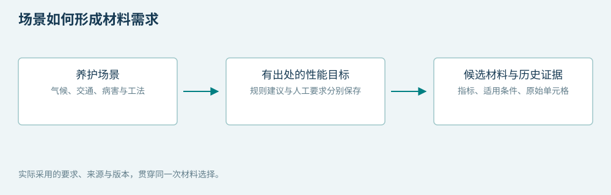
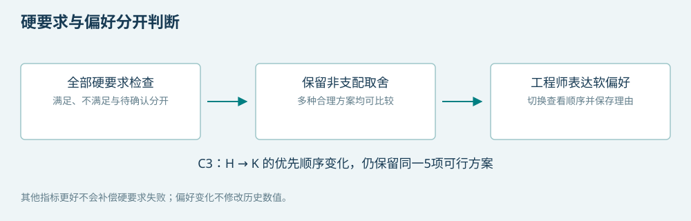
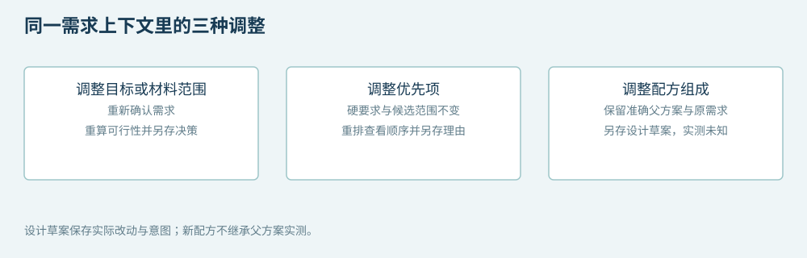

# 数智选材案例与协同设计演示说明

本轮新增“案例与设计”工作区，把场景需求解释、多目标偏好比较和准确父配方探索放在连续操作中。入口为 `http://127.0.0.1:8766/?view=design`。创意交付以可操作原型、五案对照与清楚的设计机制验收。

## 启动与复现

在已完成 `scripts/setup.ps1` 的目录执行：

```powershell
powershell -ExecutionPolicy Bypass -File scripts/start-creative-demo.ps1
```

该入口使用独立的 `artifacts/polish-v7/ui-demo.sqlite`，首次从原始本地库建立副本。后续启动保留其中的案例、取舍和草案。原始工作簿、默认库及历史交付证据保持原样。

软件回放在临时数据库中执行，另存五案卡、快照与检查记录：

```powershell
.venv\Scripts\python.exe -X utf8 scripts/replay_creative_workbench_v7.py
```

输出位于 `artifacts/polish-v7/runs/` 的时间目录，最新成功位置登记在 `artifacts/polish-v7/latest-replay.json`。`index.html`是五案入口；每张HTML卡来自实际保存记录，对应完整JSON快照以`.json.gz`保存。回放副本和浏览器演示库中的记录编号各自独立。

## 三项机制及实现

### 场景需求解释



需求解析、确认和关系路径使用原有v2模块。新工作区显示实际命中的规则、目标、单位、出处和人工覆盖记录，可继续打开材料卡与原始单元格。场景切换后，对比两份实际保存决策，展示输入、规则、目标与候选判断变化。

### 多目标偏好比较



比较复用原有全硬要求筛选和字典序排序，再独立接收优先顺序。服务端仅重排同一保存决策中的可行候选，检查前后可行ID集合一致，保留并列和非支配关系。每个方案给出与首位方案首次出现差别的指标。双轴图与数值差额表使用实际历史值及本案例目标。

C3的五个可行方案均非支配。TSR优先查看H，残留稳定度优先查看K，应变优先查看R7；这三种查看顺序都保留原五项。图中材料颜色按稳定ID分配，切换偏好不换色。

### 保持上下文的协同设计



从选中的历史材料进入准确父方案的研究假设列表。锁定油石比或组分名义份额是对已有目录的筛选。无匹配假设时显示空结果，不替换父方案。保存草案前检查原决策、数据与研究证据版本，并保存需求上下文、实际改动和设计意图。

为保持连续操作，配方探索直接嵌入案例页，提供返回方案比较按钮，复用既有研究服务的数据、支持范围和配方明细。它实现了规划中跨模块衔接的目的，操作时无需离开当前案例。

要求修改有单独的只读预览，确认后生成新需求与新决策。偏好切换不改要求；配方修改不继承父方案实测；这些变化各自保存。

## 五案操作卡

| 案例 | 工程问题 | 原案例结果 | 建议操作与观察 |
| --- | --- | --- | --- |
| C1 | 为什么高温重载路段推荐这两种材料 | 84条目录，2项数值可行 | 展开要求出处；比较H与S候选；打开材料组成和原始记录；切换C2后比较场景差异 |
| C2 | 应变相同时怎样选择并继续设计 | 2项数值可行，应变均为2525με | 解释后续TSR取舍；选R4进入其10个假设，其中7个在支持范围内；比较4.9%到5.0%的油石比假设并保存草案 |
| C3 | 五种方案均合理时怎样取舍 | 5项可行且均非支配 | 从TSR优先切换残留稳定度优先，观察H变K；填写理由并保存取舍 |
| C4 | 提高名义RAP要求后还有方案吗 | 70%要求下有1项数值可行 | 预览75%要求，看到数值可行1变0；填写理由后再确认新要求；旧记录仍可读 |
| C5 | 没有可行方案时下一步做什么 | 84条目录为证据不足 | 明确切换35条完整数值子池，查看四组冲突及一组删除见证；再选择核对资料、调整要求或探索配方 |

C1至C5是合理构造场景，历史数值来自企业工作簿。强基准B1采用相同候选、目标及可见数值，五案可行集合一致，分别为2、2、5、1、0。作品的操作价值通过需求出处、取舍理由和调整记录说明。

C4展示的是名义比例的资源要求，质量分母仍待确认。C5的删除见证仅适用于证书剩余子集，不能据此认为全部原要求已可满足。新设计计算值在可选区域展示，实际性能继续未知。

## 七分半演示脚本

| 时间 | 页面动作 | 讲解重点 |
| --- | --- | --- |
| 0:00至0:35 | 打开案例与设计，指出五个工程问题 | “作品帮助工程师从养护需求出发，理解材料选择，并在条件变化时继续设计。” |
| 0:35至1:40 | C1确认选材，展开目标出处，勾选两个材料 | “要求与来源一起保留，材料证据可以追到原始记录。”说明2项可行和同池B1一致。 |
| 1:40至3:00 | C3运行后切换TSR与残留稳定度优先，保存理由 | “五项都满足要求，工程师仍需要取舍。首位H变K，全部可行候选和硬要求不变。” |
| 3:00至4:45 | C2解释应变并列，从R4进入油石比5.0%假设，填写设计意图并保存 | “选型结果能成为继续设计的起点。保存原需求与组成改动，新配方实测保持未知。” |
| 4:45至5:40 | C4展开要求调整，预览名义RAP75% | “资源要求改变会重新筛选，预览不修改原记录；确认后才能生成新决策。” |
| 5:40至6:50 | C5运行完整目录，再明确切换完整数值子池，展开一组证书 | “资料不足与范围内已知冲突是不同结论。系统帮助工程师决定补资料、改要求还是探索配方。” |
| 6:50至7:30 | 回看草案，展示JSON与打印入口 | “需求、比较理由和设计意图都可复用和交接，三项机制已形成连续操作。” |

演示前可先运行一次各案例，熟悉滚动与展开位置；正式演示时按按钮另存自己的记录。遇到数据或证据版本不匹配时，重新运行场景，不手工更改指纹或借用旧记录的新结论。

## 答辩问答

**创新主要体现在哪里？** 场景要求、材料证据和工程师调整形成连续决策机制。目标、偏好、配方三种变化具有不同的重算和保存规则，工程师能看清每次操作的含义。

**与全约束查表相比有什么增加？** 正确给定全部数值要求时，强B1与作品可行集合一致。作品提供需求来源、非支配取舍、变化前后说明和带上下文设计草案；这些是本轮展示的新增操作能力。

**五个可行方案全部非支配，分析还有作用吗？** 这说明当前指标下存在真实取舍。工程师切换优先项可以看到不同候选被优先查看及其让步，不把多个合理选择压成无法解释的唯一分数。

**为什么C2不只说R4低温性能最好？** 两个可行候选的历史应变同为2525με。默认顺序继续比较TSR等后续指标，界面保留并列事实及首次差别。

**油石比4.9%到5.0%意味着性能改善吗？** 它是已有目录内的设计假设，用来演示继续设计、组成比较和理由保存。当前不预设其性能改善，新配方实测仍为空。

**场景规则能代表所有真实项目吗？** 当前覆盖三类明确的演示规则和五个构造案例。真实项目可输入有出处的要求，方法、条件或适用性缺失时保留待确认状态。未匹配场景不会自动套用演示规则。

**C5前后结论不同是否矛盾？** 完整84条目录保留缺测，不能证明联合无解；35条子池数值完整，能对该范围显示冲突。界面在切换时同时说明范围变化。

**为什么还展示研究预测？** 它辅助说明后续建模路线，并与历史数值分开展示。当前硬要求筛选使用相应历史证据，研究预测没有参与通过判定。

**能宣称减碳、降本或节时多少吗？** 本轮用案例说明减少资料查找、显式保留取舍理由和组织设计过程的潜在价值。缺少价格、因子及真人计时依据时，不给实际收益百分比。

**实用性由什么支撑？** 已有工作簿、可查询的数据结构、本地可运行的软件、同池对照案例、导出记录和接口契约共同支撑概念原型。实物实验与生产集成可在后续联合研发中扩展。

## 新接口与交接

新接口前缀为 `/v5/design`：`cases`读取场景卡，`cases/{id}/runs`生成案例记录，`preferences`预览或保存取舍，`decisions/{id}/adjustment-preview`只读预览要求变化，`explorations/{decision}/{parent}`按准确父配方及锁定项读取假设，`drafts`保存设计草案。`records/{id}`及其JSON、打印入口读取同一份保存内容。完整契约见 `docs/api-creative-v7.openapi.json`。

当前仍为单人本地创意原型。操作确认字段不代表多用户授权或工程审批，导出的指纹用于核对保存内容与版本。完整回放、浏览器检查、测试结果和执行状态分别保存在 `artifacts/polish-v7/`。
