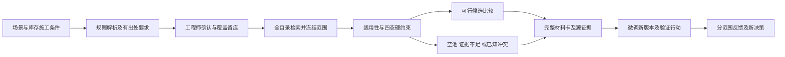

# 数智选材 v0.2 技术报告

## 目标与赛题对应

作品围绕企业课题一的“养护场景—材料性能需求—候选方案—推荐依据”流程设计。目标是帮助选材者明确需要什么、当前证据能判断什么、为什么没有方案以及下一步需要补什么。赛题基本成果为核心原型、至少三类结构化场景、至少五个对照案例、可复用技术交接和应用价值分析；本报告按这五项组织证据，不推定官方评分权重。

正式项目需要有出处且已确认适用的要求。当前高温、低温、水损害三类量化映射为团队构造规则，基础参考来自企业工作簿设计流程!E10–E12；提高的阈值为演示设定。C4与C5属于用户明确选择的附加构造要求模板，不声称仅凭气候与病害即可自动得出这些阈值。

## 数据范围与身份

原始工作簿提供当前180个历史操作键，包含不同试验项目的聚合记录、级配、用油、产品与来源标识。操作键不是已确认独立配方，试件行数不是独立材料样本数，来源代码也不是已核实的物理料源。

当前AC-13目录范围为84条，其中35条具有四项所需数值。检索默认保留缺测候选。只有明确选择完整数值演示子池，才按该子池作相应诊断。配方身份、方法、条件、RAP组成质量基准、改性剂和助剂未披露时保留未知，不补为零。

原始文件、旧模型、旧计划与原库行均保留。8项受保护文件和6张原库表已与基线核对一致。新/v2决策记录追加保存，/v1历史工作流兼容。

## 系统与主流程

后端使用FastAPI、SQLModel、SQLite，前端沿用React工作台。关系路径直接连接场景、要求、材料版本、观察与来源，不需要外部图数据库或在线大模型。规则和指标注册表以JSON维护，API契约和前端静态文件可离线交接。

需求、确认、候选池和决策均绑定版本与哈希。输入变化时旧结果标为过期；数据、候选、反馈、规则或代码变化可另行核对。新生成及新上游选择拒绝过期范围，旧快照仍能查看和导出。

## 亮点一 场景需求与可复核冲突

三类规则同时检查工法、层位、结构、气候、交通、病害类型与严重程度，生成量化目标、优先级、来源与规则版本。未知条件不套默认地区；不把所有开裂视为温缩。工程师覆盖保存原推导值、新值、理由与确认记录。

四态硬约束为满足、不满足、缺测、不可比。硬失败不由其他指标高分补偿。无数值为缺测，有数值但试验方法或条件不足为不可比。正式项目中未知适用条件不能自动通过。构造演示可作单独标识的历史数值比较，仍保留工程适用未知。

诊断分别处理无效场景、空候选池、证据不足和已知冲突。已知冲突必须使冻结池内每个候选至少有一项已知失败；未知本身不构成无解证据。算法枚举包含关系下最小的已知失败覆盖，并验证删除每项要求后的候选见证。若见证仍有未知，只称最小已知失败覆盖；只有其他要求均满足的删除见证才标为已验证包含最小冲突。目标较多时限制枚举并披露未穷举。

C5的35条完整数值子池复现四组冲突：DS与应变、DS与TSR、DS与残留稳定度、应变与TSR。证书绑定池与需求，复核还核对目标定义、逐候选失败覆盖和删除见证的原值。它们只说明此冻结范围中当前要求联合无解，不是物理性能定律，也不会自动放宽正式目标。

创新定位是把场景解释、证据状态、范围约束、最小冲突与下一步行动接进选材操作。最小冲突集合本身不作为新数学算法的原创声明。

## 亮点二 完整材料与证据适用

材料卡展示来源、产品、级配、油石比、计算沥青用量、名义RAP、改性剂、助剂和施工设备/窗口。原表组成权重与RAP质量基准分开，不把未披露项称为未掺加。产品标识不转换为没有证据支持的PG等级。

逐指标检查单位、方法、关键试验条件、数据范围、工法、层位、结构与施工限制，结果为适用、不适用、未知。明确不相容的检索条件可排除；未知证据继续显示。预算缺少同口径价格时不可判定，碳排和供货同理。

源证据能追到表、行与单元格，显示原值、公式、聚合方式、标签数量与适用状态。暂按独立的记录不称为已确认独立批次。微调生成新版本，父实测全部失效；改变RAP时相应级配依据也不直接继承。

这使“证据从哪来”和“是否可用于本项目”成为主界面中的两个独立判断。新配方优化仍未启用，因为组成质量基准、可靠代理及外部试验路径尚不充分。

## 亮点三 可执行验证与诚实模型边界

基础验证卡绑定候选、指标和冻结池，列出试验方法、待确认条件、建议理由及停止条件。已知硬失败的候选不作为仅待补齐试验的可行候选。数值已满足演示要求时先核查原试验适用性；无法核实时再取得同口径证据。

现有模型仅用于研究展示。实测、各指标自身离折预测和全量拟合研究预测分开，不能把独立分折称共享验证，也不给未经验证的多指标联合达标概率。四项自动选择流程的外层MAE均未优于均值基线，界面保留这些实际负结果。区间来自独立校准流程，单指标覆盖不构成工程保证。

实验室反馈和现场反馈有不同契约，演示与正式范围隔离。只有批准并明确确认条件的实验室记录可进入相应范围的选材证据；现场文字不能冒充实验室指标。反馈审核不授予新微调正式训练资格，不触发自动再训练或模型发布。高级决策价值补测与共享分组模型研究依人力选择延后，基础卡不宣称最优试验或节约真实试验费用。

## 五案例同池对照

每案的B1与V2使用同一个冻结84条AC-13目录池、同一数值目标和可见历史标签。B0为预先登记单指标弱方法，仅作忽略其他要求的风险示例。B1保留原全约束加单优先级，需求正确给定时允许与V2相同。

| 案例 | B1数值可行数 | V2数值可行数 | V2范围内结论 |
| --- | ---: | ---: | --- |
| C1 高温重载 | 2 | 2 | 存在数值满足候选，工程适用待审 |
| C2 低温抗裂 | 2 | 2 | 存在数值满足候选，工程适用待审 |
| C3 水损害 | 5 | 5 | 存在数值满足候选，工程适用待审 |
| C4 高RAP | 1 | 1 | 名义RAP等数值满足，质量基准待核实 |
| C5 复合要求 | 0 | 0 | 包含缺测的完整目录中证据不足 |

C5另有明确限定的35条完整数值子池报告，给出四组冲突及见证。B0在C2、C4、C5所选最高单指标候选有其他已知失败；这些是构造软件案例结果，不是行业错误率。

需求识别、模型误差和推荐验证分别评价。构造案例回放不能作为真实地区需求识别准确率或独立工程推荐成功率。

## 可行性与已完成验证

实现复用既有单机工程和企业工作簿，不依赖外部服务。原计划为单人六个相对周、每周15–20小时；72小时核心估算和18小时缓冲是规划容量，不是本轮实际人工投入。执行记录将自动化时间与未知人工工时分开。

65项Python检查覆盖旧流程及新关键边界，另完成前端类型与生产构建、12类负例、双尺寸浏览器验收、2400ms响应延迟和错误恢复、两次隔离完整流程排练。发布包核验所有文件哈希及搬迁路径，运行旧接口、模型和V2需求到冲突证书、HTML报告的流程。离线结论限于已安装依赖的本机，不包括全新系统安装或企业生产部署。

三项代表任务的九流程代理记录了实际软件步骤、准备过程、顺序、时延和原生审计缺项。执行者为AI，真人参与数0，人工时间为空；不从脚本时延推断真人节时、行业平均收益、成本、碳排或寿命提升。

## 交接与外部验证

代码、规则、指标契约、反馈JSON Schema、OpenAPI、测试、五案报告、冻结压缩快照及复现脚本随运行包保存。requirements-acceptance.json逐条挂接基本成果与三个亮点的证据。

下一步外部验证应优先获得真实场景要求及方法条件、确认材料身份和组成质量基准，再开展独立材料试验、真人完整任务测时和企业接口联调。只有取得这些证据后，才扩大工程适用、自动配方探索和受控模型训练发布的承诺。
