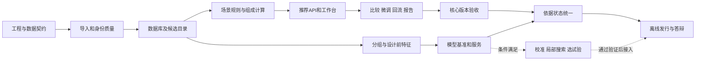

# 数智选材单人六周开发计划

计划日期：2026年10月18日。执行人数为1人，周期为6周，赛事提交截止日期尚未确定。依据为[作品详细设计](https://chatgpt.com/space/page_b3e90ae7e0a88191967a4234479f66dd)及当前工作区已有成果。

开发顺序确定为：先固化数据和规则，第2周打通场景到推荐，第3周完成可比较、可回流、可导出的核心版本，第4周完成模型基准，第5周按条件增加区间与局部搜索，第6周完成验收和答辩交付。所有开发任务由同一人执行，工序按依赖推进。

计划共39项任务，估算150小时，另留30小时用于修复、联调和资源变化。P0核心任务为128小时，P1条件增强为19小时，P2验证准备为3小时。高级算法没有可靠结果时，核心应用仍须完成，并保留清楚的能力说明。

# 开发执行记录

已完成0.1.0本地研究原型及34项P0验收。39项计划任务中37项已完成，自动配方优化1项因RAP质量基准与原料关联未确认而按条件跳过，独立验证准备1项已就绪并等待企业评议或实测。六周和150小时仍是原估算，不代表实际历时或投入。

正式导入保留2052试件行、68级配块和44来源代码，形成180个操作配方键；五案例实时筛选分别返回R1、R4、R7、R5和空。微调性能失效、试验审核与范围隔离、原始单元格追溯和不可变报告均已实现。18项自动化检查通过，完成两次全新进程与隔离数据库排练。推荐接口中位响应约49毫秒和43毫秒；为本机小样例结果。

四项模型自动选择流程的外层MAE均未优于均值基线，预测保留研究模式。研究区间采用12个独立校准组与8个测试组，需分组可交换性，不能解释为工程或多指标联合达标保证。未取得企业验证、独立实测、价格、碳排和道路寿命资料。

交付包含本地应用、Windows启动脚本、依赖锁、数据及模型版本清单、HTML与JSON报告、答辩脚本、真实界面截图及30秒无配音的分步MP4回放。视频由实际截图顺序编码，完整软件流程另见两次排练日志。同机异目录启动和文件哈希已验证，尚未在全新电脑重装验收。

# 1 时间与执行约束

| 项目 | 约定 |
|---|---|
| 已确认 | 单个开发者，按6周安排 |
| 容量假设 | 每周5个工作日，每天6小时有效开发，共180小时 |
| 开发预算 | 150小时，约25个有效工作日 |
| 缓冲预算 | 30小时，约5个有效工作日 |
| 日期口径 | W1至W6为相对周次，D1为正式启动的第一个工作日，不推定比赛截止日 |
| 分工方式 | 数据、后端、前端和验证由同一开发者轮换承担，不叠加计算并行产能 |
| 状态口径 | 本地0.1.0原型已开发并验收；实际状态以开发执行记录与本地任务清单为准 |

每天6小时是有效开发时间的假设，不是对实际可投入时间的确认。若每周只能投入20小时，150小时任务和30小时缓冲合计约需9周。保持6周期限时，应先减增强范围，再检查核心128小时是否仍超过可用容量。

每周预算为：前5周各26小时任务和4小时缓冲，第6周20小时任务和10小时缓冲。未消耗缓冲优先保留到联调与发布阶段。

# 2 当前成果与迁移工作

| 已有内容 | 可复用价值 | 需要补齐 |
|---|---|---|
| 赛题与领域调研、详细设计 | 已确定作品主线、场景与证据边界 | 转成可执行范围和验收记录 |
| 原始工作簿解析脚本 | 已读取原料、级配和性能表 | 显式输入路径、布局校验、幂等导入和稳定主键 |
| 派生证据和质量问题定位 | 可复用单位、别名、用油、曲线和疑似均值线索 | 字段级质量状态与正式候选关联 |
| 9个候选、5个构造场景回放 | 可作为固定回归样例 | 接入正式服务，保留构造目标标识 |
| 场景切换交互样例 | 可参考比较逻辑和来源展开方式 | 改为应用页面并由后端统一判定 |
| 本地设计文档与Page | 可作为产品与技术基线 | 与最终实现、数据和模型版本同步 |

应用工程和本地Git仓库已建立，项目专用Python 3.12.14环境及Node 24.19.0前端可运行。后端与前端依赖分别锁定在requirements.lock.txt和frontend/pnpm-lock.yaml；原始工作簿保持原样。首次依赖安装需要网络，核心运行使用本地资源。

已有脚本不是正式导入器。例如自动选择目录中第一个Excel、依赖固定列号和局部名称启发式，都应在DAT-02和DAT-03中显式配置与核验。所有记录进入暂存层，可用于建模的记录由独立条件筛选。

# 3 六周交付范围

## 3.1 核心任务

P0要求完成以下可运行能力：

1. 导入原始工作簿，生成版本化材料目录，保存单元格来源、单位和质量状态。
2. 覆盖高温车辙、温缩开裂、水损害三类需求，支持5个构造案例重放。
3. 输入场景、确认目标、推荐候选、比较性能，并解释排除与缺测。
4. 修改允许的方案参数后创建新版本，使旧方案确认状态失效。
5. 录入试验、审核回流并导出HTML报告和JSON快照。
6. 建立四项性能的逐指标模型基准与分组评估，明确每个指标能支持的预测范围。
7. 在本地启动和离线演示，提供可复现的数据、接口、模型说明与答辩材料。

模型基准的完成标准是实验有效、结果可重现、边界可说明。若数据关联或独立组数不足以支持某个模型，该指标应交付可核验的能力边界和已有对照，应用维持历史证据与待补测状态。

## 3.2 有条件增强

P1包括GPR对照、预测区间校准、少量变量的局部候选搜索、下一项试验建议及小型候选池回放。每项设进入条件和降级路径，不作为P0的硬依赖。

P2用于专家评议或独立试验的准备。3小时仅估算开发者整理方案、资源与记录的时间，不包含材料制样、检测、专家工作和等待周期。取得独立验证时可追加证据，但不据此挤占核心发布工时。

TabPFN、多任务GP、成本感知BO、LLM工具调用和RAG属于后续研究候选，本轮不纳入150小时基准排期。真实成本碳排、现场寿命、光谱、疲劳与动态模量扩展，需要相应数据后另行立项。

# 4 工程方案与目录

## 4.1 技术选择

| 部分 | 首版选择 | 目的 |
|---|---|---|
| 后端 | Python 3.12项目环境、FastAPI、Pydantic | 复用数据和模型代码，保持输入输出契约一致 |
| 存储 | SQLite与SQLModel | 单机文件数据库，减少单人部署维护工作 |
| 前端 | React、TypeScript、Vite | 建立可持续迭代的场景工作台与方案详情 |
| 数值与模型 | NumPy、pandas、scikit-learn | 组成计算、分组基准和逐指标预测 |
| 测试 | pytest、接口集成检查和核心浏览器流程 | 验证单位、边界、状态和完整业务链 |
| 交付 | 前端静态构建由后端服务，本地启动脚本 | 演示运行阶段使用同一个应用入口 |

具体依赖版本在ENG-01试装兼容后锁定。FastAPI官方示例提供SQLModel与SQLite的组合，适合本轮单机原型；Vite的运行时要求应在启动环境检查中核对。[FastAPI数据库文档](https://fastapi.tiangolo.com/tutorial/sql-databases/)，[Vite官方指南](https://vite.dev/guide/)

首版采用模块化单体，训练由命令行离线执行，应用加载已审核的模型与数据版本。关系记录和规则文件支撑场景到材料的查询，图谱关系可作为视图展示。

## 4.2 应用界面

页面收敛为三个主要入口：场景推荐工作台、方案详情与比较、试验及验证记录。规则出处、数据问题、模型说明和报告采用详情面板或相关操作入口，减少多页面状态同步。

工作台展示用户需要确认的目标和候选状态。方案详情展示比例、级配、用油、逐项性能与来源。验证记录负责观察录入、审核、更正和更新依据。

## 4.3 拟建目录

以下是ENG-01之后的目标结构，当前仅作为工程约定：

```text
backend/
  app/api/             场景、目录、推荐、观察、报告接口
  app/domain/          身份、单位、规则、组成和判定
  app/repositories/    数据库读写和版本管理
  app/services/        推荐、证据、方案版本和报告
  app/ml/              数据视图、划分、训练、评估和预测
frontend/
  src/features/        场景、比较、详情、试验记录
  src/api/             类型与接口访问
configs/               工作表布局、规则和运行配置
data/                  原始资料登记、处理快照和本地数据库
artifacts/             评估、模型卡、模型和报告
tests/                 关键边界、接口和流程检查
scripts/               导入、训练、评估、启动和打包
planning/              排期、任务和验收进展
```

原始文件继续按哈希登记，处理结果写入派生目录。运行脚本接受输入路径与配置，发行包不依赖开发机的绝对目录。

# 5 数据与接口先冻结的内容

## 5.1 六类契约

| 契约 | 必须明确的内容 |
|---|---|
| 材料与配方身份 | 来源代码、材料批次、完整级配、局部产品版本、实际用油与关联状态 |
| 性能观察 | 指标名、原值、标准单位、组别、条件、聚合方式、原始单元格 |
| 场景目标 | 工法、结构层、病害、交通气候、可用材料、运算符及目标出处 |
| 推荐结果 | 数值筛选结果、依据完备程度、未满足与缺测事项、版本快照 |
| 模型产物 | 数据、特征、划分、代码、模型版本与支持的任务范围 |
| 试验回流 | 新观察身份、审核状态、更正关系、演示或正式数据属性 |

把“数值满足所设目标”和“证据足以进入确认”分别保存。当前五案例中数值初筛进入候选的身份应保持一致，原料或试验身份仍有疑点时继续显示待核验，不把回放通过转换成工程验收通过。

TSR统一为百分数且只转换一次。零值、缺测、参考属性和预测值分别处理。RAP比例保留原表口径；质量基准未确认时，局部改配计算返回具体待确认原因。

## 5.2 接口顺序

| 顺序 | 接口 | 验收关注点 |
|---|---|---|
| 第1周 | GET /health | 环境和数据版本可检查 |
| 第2周 | GET /v1/catalog 与 GET /v1/rules | 可用目录、状态与规则出处 |
| 第2周 | POST /v1/scenarios/resolve | 目标、冲突和缺失条件 |
| 第2周 | POST /v1/recommendations 与 GET /v1/recommendations/{id} | 快照、每指标依据、排除与空候选 |
| 第3周 | POST /v1/recipes/{id}/variants | 新版本与旧结果失效 |
| 第3周 | POST /v1/observations 及审核接口 | 单位、组别、幂等、更正和训练可用性 |
| 第3周 | GET /v1/recommendations/{id}/report | 可追溯HTML及结构化快照 |
| 第4周 | POST /v1/predictions | 模型版本、能力范围与不可用状态 |
| 第5周增强 | POST /v1/experiment-plans | 可读的待测项目与选择依据 |

前端统一使用API返回的判定与数值，不再实现第二套阈值计算。区间尚不可用时返回空值和原因，预算为硬约束而成本数据缺失时也须明确说明无法完成相应比较。

# 6 周计划与验收关口

| 周次 | 计划加缓冲 | 交付版本 | 进入下一阶段的依据 |
|---|---:|---|---|
| W1 | 26h加4h | 数据与契约版本 | 可重建目录，单位与身份有状态，核验事项可定位 |
| W2 | 26h加4h | 场景到推荐版本 | 五案例从页面调用服务，空候选与排除理由正确 |
| W3 | 26h加4h | 核心应用版本 | 比较、来源、方案版本、试验回流与报告可演示 |
| W4 | 26h加4h | 模型基准版本 | 划分与特征可审计，误差和边界可重现，预测接口可用或说明不可用 |
| W5 | 26h加4h | 风险状态与增强冻结版本 | 依据状态一致，已启用增强通过检查，未完成增强明确关闭 |
| W6 | 20h加10h | 参赛发行版本 | 离线重放、交接、答辩与发布清单一致 |

W3末必须已有可用的演示版本。此后模型与增强逐项接入，发布流程始终保留可回退的核心应用。

W4末冻结本轮模型家族和评价协议。W5末冻结功能范围。W6仅处理阻碍交付的缺陷、复现、材料与排练，不增加新的算法或基础设施。

# 7 第一周逐日安排

| 工作日 | 任务与时间 | 当天产出 |
|---|---|---|
| D1 | ENG-01 4h，DAT-01前2h | 工程可启动；身份、单位和快照字段草案 |
| D2 | DAT-01剩余1h，DAT-02前5h | 契约定稿；主要工作表可解析 |
| D3 | DAT-02剩余1h，DAT-03 5h | 导入基线可重现；身份与质量问题有独立状态 |
| D4 | DAT-04 4h，BIZ-01 2h | 数据目录可查询；企业核验单和待确认清单 |
| D5 | TST-01 2h，缓冲4h | 导入验收记录；修复本周暴露的问题 |

D1先记录实际运行环境，再锁依赖。D3对未确认字段采用隔离策略，D4依据已完成的定位整理核验单。收到企业反馈后以新版本更新关联；未收到时继续开发已支持的范围。

当天任务未完成时，记录剩余工作和阻塞点，从本周缓冲中扣除实际修复时间。任何持续超过原估算半天的任务应重新拆分和估算。

# 8 依赖与单人执行方式



图中支路表示技术依赖，不表示单个开发者同时开展多项工作。周内先完成硬依赖，每次聚焦一个主动开发任务；模型训练等待时间可用于整理同一任务的记录，但不把等待当作额外产能。

任务完成必须留下可查看的产物、验收结果和版本。每次跨数据、规则或模型版本变更，记录会影响哪些候选和评估。任务状态按未开始、就绪、进行中、待外部信息、完成、按条件跳过管理。

遇到外部等待时，应转向无依赖任务，并保留已有功能适用范围。不可把未确认别名或假设阈值静默填成已确认值。

# 9 模型开发与实验控制

第4周先冻结两类评价：未见完整配方，以及未见来源族或完整材料表征。平行试件、疑似派生均值和同一方案记录留在同组。跨代码复用需要依据完整材料证据判断，通用矿粉单曲线相同不足以合并所有来源。[scikit-learn分组交叉验证文档](https://scikit-learn.org/stable/modules/cross_validation.html)

先运行常数、近邻、岭回归与随机森林，分别预测DS、低温应变、TSR和残留稳定度。3小时GPR任务在基准稳定后进入；所有模型使用相同的允许输入和外层划分。[scikit-learn高斯过程文档](https://scikit-learn.org/stable/modules/gaussian_process.html)

超参数搜索限制在预先声明的小型配置中，只使用内层训练数据。保存逐组外层预测、误差、阈值误判、有效组数及失败原因。R²等指标在对应样本条件不满足时标记不可计算，不以零替代。

模型上线按指标分别决定：输入可获得、分组评估有效、相对业务基线的表现和临界误判有依据，才进入推荐辅助。无法支持时保留研究对照与历史证据，不能用训练集精度掩盖泛化不足。

第5周的校准必须使用独立于训练与调参的组；区间对应的预测目标应明确。样本不足、来源迁移或联合达标无法证明时，保持区间不可用及相应提示。局部搜索只能在组成口径和支持范围清楚时启用，所有新候选仍需独立验证。

# 10 验收与测试范围

## 10.1 每周必须验证的业务行为

| 类别 | 关键验收 |
|---|---|
| 导入 | 显式文件、哈希、合并区域、重复导入、错误公式、未知字段 |
| 规则 | 严格大于、至少、区间边界、单位、适用条件冲突 |
| 推荐 | 缺测与失败并存、候选为空、局部产品身份、排序不抵消失败 |
| 微调 | 新旧方案区分、实测不继承、超范围与比例不一致提示 |
| 回流 | 试验组与条件、审核、重复提交、更正、演示记录隔离 |
| 模型 | 分组隔离、设计前特征、训练期变换、版本匹配、模型缺席回退 |
| 报告 | 数字与状态一致、来源可定位、数据和规则版本完整 |

测试集中在这些会改变工程判断或破坏重现性的行为。页面间距、颜色等低影响调整采用视觉核对，不扩展为大量镜像实现的测试。

## 10.2 发布验收

固定五案例的数值初筛结果应与既有回放基线一致：前四例各有对应历史候选进入核验，第五例为空。应用可以增加更严格的证据待确认状态，但须解释差异。

发布前完成一次从重新建库开始的重放、一次断网核心流程检查，以及两次从启动到演示结束的排练。新的演示观察在独立演示数据空间操作，不污染正式训练集。

工程性能目标暂定为：目标机上100个候选的规则推荐热请求p95不超过1秒、常用详情查询p95不超过0.5秒。第6周各记录至少50次请求的环境、输入规模和实际耗时，未测量前不写成已达成效果。首次依赖安装不计入该响应时间。

应用没有模型、外部网络或企业接口时，基础案例和规则流程仍能运行。发行清单只列实际实现并验收的功能。

# 11 风险与削减规则

| 风险 | 触发条件 | 采取的动作 |
|---|---|---|
| 数据核验延迟 | 周末仍存在影响特征的别名、曲线或用油问题 | 隔离对应字段，保留可信性能与待确认状态，公开有效覆盖 |
| 可建模组数不足 | 冻结后某指标不能支持预定划分或校准 | 缩小该指标支持范围，保留基线研究与缺测建议 |
| 模型收益有限 | 严格分组后未稳定改善业务基线 | 保留历史推荐主流程，展示真实比较与边界 |
| 前端开发超时 | W2尚未完成场景到推荐 | 停止装饰性图表，完成三入口和必要详情，使用周内缓冲 |
| 高级算法超时 | P1原工时耗尽或前置条件不满足 | 标记按条件跳过，保留接口说明，不继续无上限调参 |
| 外部验证不可用 | 资源、材料或专家时间未落实 | 交付验证设计，案例继续采用明确的历史回放 |
| 演示环境失败 | 目标机依赖、路径或网络与开发机不同 | 使用打包检查、静态资源、版本数据与备用录制材料 |

核心进度延误半天以上时先检查本周剩余缓冲。需要削减范围时，依次取消P2外部验证准备、P1试验选择回放、P1局部搜索、P1 GPR对照。区间校准若条件不足同样退出，核心仍显示真实依据缺口。不得通过放宽规则、隐去缺测或混合训练测试来追赶进度。

P0之间没有P1或P2硬依赖。可选产物以可选输入接入，所以跳过增强不会造成核心任务的依赖断裂。

# 12 交付清单与版本记录

| 交付物 | 最晚节点 | 内容 |
|---|---|---|
| 可重建数据与问题登记 | M1 | 导入器、数据字典、原始来源、关联和质量状态 |
| 核心演示应用 | M3 | 场景、推荐、比较、微调、回流、报告 |
| 模型基准与能力说明 | M4 | 划分、特征、逐组结果、模型卡及运行版本 |
| 增强功能状态 | M5 | 已启用、未满足条件和跳过原因 |
| 发行与复现包 | M6 | 代码版本、依赖锁、启动说明、数据模型和报告 |
| 答辩与案例材料 | M6 | 五案例、对照、演示脚本、录制和已知边界 |

每次验收记录输入版本、代码提交、结果文件和未完成事项。第6周冻结参赛版本，之后如需修复阻碍演示的问题，必须重跑受影响流程并更新发行清单。

下一项可执行任务是ENG-01：建立项目环境、后端健康检查和前端空工作台。随后DAT-01冻结身份、单位与版本契约，避免后续导入、推荐、界面和模型采用不同的数据含义。

# 13 每项任务与验收

下列任务与机器可读任务清单一致。工时为单人有效工作估算，所有任务目前为未开始，ENG-01可直接启动。P1和P2允许按进入条件跳过，并登记原因。

## 第1周任务

本周计划26小时，缓冲4小时。

| 编号 | 任务 | 优先级 | 工时 | 依赖 |
|---|---|---|---:|---|
| ENG-01 | 建立可运行工程和依赖锁定 | P0 | 4h | 无 |
| DAT-01 | 冻结数据字典与单位身份契约 | P0 | 3h | ENG-01 |
| DAT-02 | 将原始工作簿解析固化为导入器 | P0 | 6h | DAT-01 |
| DAT-03 | 建立身份关联与字段质量隔离 | P0 | 5h | DAT-02 |
| DAT-04 | 建立SQLite存储和版本化候选目录 | P0 | 4h | DAT-03 |
| TST-01 | 验证导入和数据转换边界 | P0 | 2h | DAT-04 |
| BIZ-01 | 形成企业数据核验单与响应登记 | P0 | 2h | DAT-03 |

### ENG-01 建立可运行工程和依赖锁定

交付物：Python项目与React应用骨架、依赖锁文件、本地健康检查。

验收：独立项目环境能够启动健康检查和空白工作台；记录Python、Node和依赖版本，原始资料不被改写。

### DAT-01 冻结数据字典与单位身份契约

交付物：字段字典、枚举和数据版本规则。

验收：区分原值、标准值、参考值和派生值；约定来源、完整级配、局部产品、油石比、试验组和来源单元格。

### DAT-02 将原始工作簿解析固化为导入器

交付物：显式输入路径的导入命令、工作表布局配置、导入结果清单。

验收：重现当前文件的9表、68级配块和2052明细基线，定义一致；仅在真实合并区域展开身份，保留原单元格、公式和文件哈希；重复导入同一文件不产生重复记录。

### DAT-03 建立身份关联与字段质量隔离

交付物：关联状态表、质量问题清单、可用标签与特征清单。

验收：保留exact、confirmed_alias、conditional、unresolved关联状态；疑似均值、曲线差异、用油异常不自动修正；可靠性能与不可靠输入按字段处理，分别统计可用覆盖。

### DAT-04 建立SQLite存储和版本化候选目录

交付物：数据库模型与建库脚本、目录查询、数据快照。

验收：记录原始观察、候选版本、规则版本和证据来源；完整关联候选与部分观测候选分开保存；重启后数据仍可查询，同一快照可重建。

### TST-01 验证导入和数据转换边界

交付物：导入回归与异常样例、首轮核验记录。

验收：TSR小数转百分数仅转换一次，零值与缺测可区分；合并单元格、错误公式、重复导入和未关联记录有明确处理。

### BIZ-01 形成企业数据核验单与响应登记

交付物：问题定位与影响说明、回应和待确认事项登记。

验收：定位配方别名、疑似均值、曲线与用油问题；未获得回应时明确保留状态及受影响功能，不阻塞基础流程。

## 第2周任务

本周计划26小时，缓冲4小时。

| 编号 | 任务 | 优先级 | 工时 | 依赖 |
|---|---|---|---:|---|
| RUL-01 | 建立三类场景与规则卡 | P0 | 4h | DAT-01、DAT-04 |
| CAL-01 | 实现组成与用油一致性计算 | P0 | 3h | DAT-04 |
| RUL-02 | 实现候选筛选与排除解释 | P0 | 4h | RUL-01、CAL-01 |
| API-01 | 提供场景和推荐核心接口 | P0 | 5h | RUL-02、DAT-04 |
| WEB-01 | 搭建工作台和场景确认流程 | P0 | 4h | API-01 |
| WEB-02 | 展示材料目录与基础依据 | P0 | 3h | WEB-01 |
| TST-02 | 打通五案例的API和页面流程 | P0 | 3h | WEB-02、API-01 |

### RUL-01 建立三类场景与规则卡

交付物：高温、温缩、水损害场景模式、规则JSON和适用条件。

验收：企业流程参考、项目目标、演示假设分别标注；规则保存出处、单位、运算符、方法和条件，不将构造值标成规范值。

### CAL-01 实现组成与用油一致性计算

交付物：比例、级配、油量计算模块、可计算与待确认状态。

验收：在确认的质量基准下检验比例和、加权曲线与油石比转换；质量口径或原料关联未知时返回待确认，不输出伪精确配方。

### RUL-02 实现候选筛选与排除解释

交付物：规则推荐服务、逐指标判定与证据状态。

验收：严格大于与至少等运算符按规则执行；缺测不视为通过，失败与缺测同时保留；先筛硬约束，再按偏好排序，不用综合分抵消失败。

### API-01 提供场景和推荐核心接口

交付物：场景解析、材料查询、推荐与详情API、OpenAPI与错误样例。

验收：输出包含输入快照、方案和规则版本、每项数值来源；数据问题与系统异常可区分，空候选是有效结果；API成为判定的唯一计算来源。

### WEB-01 搭建工作台和场景确认流程

交付物：应用壳层、场景输入与目标确认。

验收：能选择构造案例并修改结构化场景；缺失必填或规则冲突在提交前后均可见，不静默采用默认气候。

### WEB-02 展示材料目录与基础依据

交付物：候选目录、产品和级配基础信息。

验收：从正式API展示可关联目录，9候选仅作为固定样例集；局部产品、名义RAP口径和未确认字段可见。

### TST-02 打通五案例的API和页面流程

交付物：场景到推荐的集成检查、第二周演示版本。

验收：五场景的数值筛选结果与固定回放基线一致；C5正确返回空候选，确认状态不被解释成工程验收通过。

## 第3周任务

本周计划26小时，缓冲4小时。

| 编号 | 任务 | 优先级 | 工时 | 依赖 |
|---|---|---|---:|---|
| WEB-03 | 完善多方案比较和空结果处理 | P0 | 4h | TST-02 |
| WEB-04 | 展开单元格证据和数据问题 | P0 | 4h | WEB-03 |
| REC-01 | 实现方案版本与人工微调 | P0 | 4h | WEB-03、CAL-01、API-01 |
| OBS-01 | 实现试验录入与审核回流 | P0 | 5h | DAT-04、API-01、WEB-04 |
| OUT-01 | 生成可追溯的推荐报告 | P0 | 4h | WEB-04、REC-01 |
| TST-03 | 验收核心业务闭环 | P0 | 3h | REC-01、OBS-01、OUT-01 |
| DEM-01 | 整理五案例与首次演示脚本 | P0 | 2h | TST-03 |

### WEB-03 完善多方案比较和空结果处理

交付物：性能与目标差距比较、候选选择和排除视图。

验收：切换场景会改变目标、候选和排除理由；缺测维度留空，未知成本和碳排不显示虚构数值。

### WEB-04 展开单元格证据和数据问题

交付物：来源详情面板、试验记录分布与质量说明。

验收：能定位文件版本、表名、单元格及单位转换；记录极差不显示为预测区间，记录条数不等于独立批次数。

### REC-01 实现方案版本与人工微调

交付物：方案变体接口、输入差异与状态失效。

验收：修改产品、比例或用油后生成新版本；旧方案实测结果不自动继承为新方案实测值；无法计算的修改给出具体待确认项。

### OBS-01 实现试验录入与审核回流

交付物：观察录入与审核接口、验证记录页面、幂等与更正版本。

验收：保存试验组、条件、单位、数值和来源，未经审核不进入训练视图；重复提交不重复计数，更正保留旧记录；审核后可更新相应候选依据，合成演示记录与正式数据分开。

### OUT-01 生成可追溯的推荐报告

交付物：HTML报告、结构化JSON快照。

验收：包含场景、目标出处、候选、未满足事项、证据与版本；保存报告不会改变审核状态，缺失指标和模型缺席保持原状。

### TST-03 验收核心业务闭环

交付物：闭环端到端检查、第三周核心版本。

验收：场景、推荐、比较、微调、录入、审核、报告全流程可演示；同一输入和版本能重放同一规则结果。

### DEM-01 整理五案例与首次演示脚本

交付物：五案例说明与基准对照、3至5分钟操作路线。

验收：至少覆盖三类养护需求，明确构造场景与历史记录身份；同时演示成功初筛、数据待确认和无可行候选。

## 第4周任务

本周计划26小时，缓冲4小时。

| 编号 | 任务 | 优先级 | 工时 | 依赖 |
|---|---|---|---:|---|
| ML-01 | 冻结按方案和材料族的评估划分 | P0 | 4h | DAT-03、DAT-04 |
| ML-02 | 构建设计前特征和标签视图 | P0 | 4h | ML-01、CAL-01 |
| ML-03 | 运行近邻与传统模型基准 | P0 | 7h | ML-02 |
| ML-04 | 比较GPR小样本分支 | P1 | 3h | ML-03 |
| ML-05 | 完成模型选择记录与模型卡 | P0 | 4h | ML-03 |
| ML-06 | 接入预测服务和能力声明 | P0 | 2h | ML-05、API-01 |
| TST-04 | 核验评估隔离与模型装载 | P0 | 2h | ML-06、ML-01 |

### ML-01 冻结按方案和材料族的评估划分

交付物：两类划分清单、去泄漏核验、评价协议。

验收：平行试件、疑似汇总和同方案不跨训练测试；材料族按完整证据确认，不以单一通用矿粉曲线合并所有来源；记录每指标实际有效组数，关联不明部分隔离。

### ML-02 构建设计前特征和标签视图

交付物：逐指标数据构建器、训练期变换流水线。

验收：首轮预测只用设计前已知特征；填补、缩放与特征选择在允许训练部分拟合；不将未确认参考属性或生成标签当作实测数据。

### ML-03 运行近邻与传统模型基准

交付物：均值、近邻、岭回归和随机森林对照、四指标逐组预测结果。

验收：相同外层划分下报告MAE、RMSE、R²与阈值误判；调参仅在内层且设计算时间上限；数据不足或目标不满足建模条件时如实形成能力边界报告。

### ML-04 比较GPR小样本分支

交付物：固定配置的GPR对照、失败与数值稳定性记录。

验收：使用同一输入、划分和评价口径；不把GPR后验标准差直接标为已校准工程置信度。

进入条件：核心基准能重跑且剩余工时满足周预算。降级方式：保留已完成传统模型，记录未进入的分支。

### ML-05 完成模型选择记录与模型卡

交付物：逐指标评价报告、模型卡和版本清单。

验收：区分训练内表现、外层预测与独立料源表现；采用预先声明的模型选择口径，不按演示案例挑模型；没有可靠改进的指标保留案例参考或研究模式。

可选输入：ML-04。不作为核心任务的硬依赖。

### ML-06 接入预测服务和能力声明

交付物：预测API、模型版本与适用范围输出。

验收：数值区分历史观测和模型预测；不可用模型、未见产品和不支持指标返回明确状态，不伪造数值。

### TST-04 核验评估隔离与模型装载

交付物：模型集成与泄漏回归记录。

验收：更换模型版本能准确显示对应数据和特征版本；部署结果与保存的离线预测在容差内一致，缺失模型时规则流程可运行。

## 第5周任务

本周计划26小时，缓冲4小时。

| 编号 | 任务 | 优先级 | 工时 | 依赖 |
|---|---|---|---:|---|
| UQ-01 | 开展区间校准与适用性判断 | P1 | 6h | ML-05、ML-06 |
| UQ-02 | 统一依据状态与待补测交互 | P0 | 4h | ML-06、WEB-04 |
| OPT-01 | 实现有边界的局部候选搜索 | P1 | 6h | UQ-01、CAL-01、REC-01 |
| EXP-01 | 实现下一项试验的规则建议与小池回放 | P1 | 4h | UQ-02、OBS-01、ML-05 |
| TST-05 | 核验风险状态和启用的增强功能 | P0 | 3h | UQ-02 |
| BIZ-02 | 准备专家评议或独立试验方案 | P2 | 3h | DEM-01、ML-05 |

### UQ-01 开展区间校准与适用性判断

交付物：适用性检查、有数据支持时的区间校准、覆盖与宽度报告。

验收：校准组独立于训练和调参，目标对应组均值或明确的观测粒度；报告校准组数、覆盖与区间宽度，不将边际覆盖说成联合达标；不足时返回区间不可用及具体原因。

进入条件：有效样本和分组允许相应校准，模型基准通过核验。降级方式：保留数值预测的研究状态与历史证据，不填充固定百分比区间。

### UQ-02 统一依据状态与待补测交互

交付物：有依据核验、待补测、排除状态、模型和规则结果统一展示。

验收：关键指标缺测、身份不明、区间不可用与阈值冲突分别展示；即使增强区间未实现，仍能完整说明当前证据缺口。

可选输入：UQ-01。不作为核心任务的硬依赖。

### OPT-01 实现有边界的局部候选搜索

交付物：受约束的有限候选搜索、Pareto候选与来源说明。

验收：只调整已确认质量基准与范围内的少量变量；先核验组成，再评价模型适用性和性能，搜索设置有上限；新候选标为未实测，不用代理自评分证明性能提升。

进入条件：组成口径、训练支持范围与适用性处理已清楚。降级方式：维持历史方案枚举、硬筛选和比较，保留搜索接口说明。

### EXP-01 实现下一项试验的规则建议与小池回放

交付物：方案与试验项目建议、规则与随机的候选池比较。

验收：建议指出影响的选型歧义与缺测指标；回放只揭示真实历史标签，不使用预测器作为真值；无真实成本时报告查询次数及假设。

进入条件：核心工作台稳定，剩余工时足够。降级方式：仅在报告中列出人工可读的待测项目和理由。

### TST-05 核验风险状态和启用的增强功能

交付物：阈值、缺测和适用性回归、增强功能开关清单。

验收：未实现或未满足条件的增强在界面明确不可用；已启用搜索和选试验功能经过相应集成检查；候选为空不自动降低要求。

可选输入：OPT-01、EXP-01。不作为核心任务的硬依赖。

### BIZ-02 准备专家评议或独立试验方案

交付物：专家评议表或预注册试验清单、资源、条件与反馈状态。

验收：列出有区分力的对照和需要核验的参数；收到评议或实测时单独附证据，未取得时保持计划状态。

进入条件：企业或实验室资源已可用，核心交付不受影响。降级方式：保留评议与试验设计，不将等待外部结果列为发布阻塞。

## 第6周任务

本周计划20小时，缓冲10小时。

| 编号 | 任务 | 优先级 | 工时 | 依赖 |
|---|---|---|---:|---|
| TST-06 | 完成发布回归与离线验收 | P0 | 4h | TST-03、TST-04、TST-05 |
| PKG-01 | 打包本地演示和启动检查 | P0 | 4h | TST-06、OUT-01 |
| DOC-01 | 完成技术与复现交接 | P0 | 4h | PKG-01、ML-05 |
| DEM-02 | 完成答辩材料和演示排练 | P0 | 6h | DOC-01、DEM-01 |
| REL-01 | 冻结参赛版本与交接清单 | P0 | 2h | DEM-02、PKG-01、DOC-01、TST-06 |

### TST-06 完成发布回归与离线验收

交付物：核心用例验收记录、本地性能与离线检查。

验收：固定环境下五案例、微调、反馈和报告可重跑；网络断开后核心材料与规则流程仍可运行；记录真实响应耗时和故障恢复结果。

### PKG-01 打包本地演示和启动检查

交付物：Windows启动与检查脚本、前端静态构建、版本化数据与模型包。

验收：按交接说明能在目标机器启动，不依赖开发目录绝对路径；核心演示资源本地可用，缺失环境给出可执行提示；发行内容清单与数据和模型版本一致。

### DOC-01 完成技术与复现交接

交付物：README与部署说明、字段和接口字典、规则与模型边界说明。

验收：说明导入、运行、训练、评估和重放所需步骤；每个结论关联对应数据、规则、代码与模型版本。

### DEM-02 完成答辩材料和演示排练

交付物：答辩结构与图表、演示录制与故障备用材料。

验收：五案例说明完整，实际效果与目标假设区分；核心演示完成两次从启动到结束的排练；记录不能支持的指标与回答口径。

### REL-01 冻结参赛版本与交接清单

交付物：版本标签与发行清单、已知问题和验收结论。

验收：所有P0有验收记录或明确范围调整；功能状态、案例、模型报告和答辩数字一致；保留可回退的上一演示版本。

